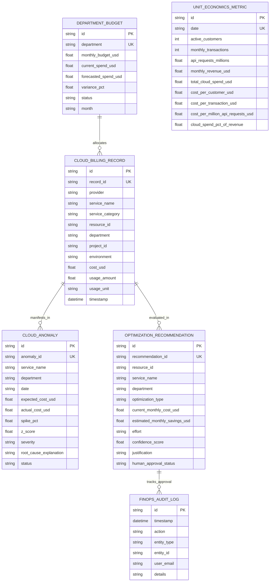

# Architecture & System Design
## AETHER — Cloud FinOps & Infrastructure Economics Intelligence Platform

**Lead Architect:** Qusai Mustafa Tailor  
**System Class:** Enterprise Multi-Cloud Financial Operations Platform  

---

## 1. High-Level System Architecture

```
                    ┌────────────────────────────────────────────────────────┐
                    │               Client Layer (Dual Access)               │
                    │  - Standalone Netlify SPA (Interactive Dark-Mode UI)   │
                    │  - In-browser scenario simulator & AI query interface  │
                    └───────────────────────────┬────────────────────────────┘
                                                │ REST API / JSON
                                                ▼
                    ┌────────────────────────────────────────────────────────┐
                    │              FastAPI Backend Gateway (Port 8003)       │
                    │  - Multi-Cloud Billing Ingest & Normalization          │
                    │  - Pydantic v2 Schema Validation & CORS Middleware     │
                    └───────┬───────────────────┬───────────────────┬────────┘
                            │                   │                   │
                            ▼                   ▼                   ▼
    ┌─────────────────────────────┐ ┌─────────────────────┐ ┌───────────────────────┐
    │ Cost Intelligence & Forecast│ │ Anomaly & Z-Score Svc││ Optimization Engine   │
    │  - Multi-Cloud Aggregation  │ │ - 30-day baseline   │ │ - Idle VM detection   │
    │  - OLS Trend Extrapolation  │ │ - Outlier detection │ │ - Orphaned storage    │
    │  - 95% Confidence Bounds    │ │ - Root-cause analysis││ - 1-Yr/3-Yr CUD plans │
    └──────────────┬──────────────┘ └──────────┬──────────┘ └───────────┬───────────┘
                   │                           │                        │
                   └───────────────────────────┼────────────────────────┘
                                               │ SQLAlchemy ORM (WAL Mode)
                                               ▼
                    ┌────────────────────────────────────────────────────────┐
                    │                   Data Persistence Layer               │
                    │  - SQLite (Production-grade with WAL Pragmas)          │
                    │  - Multi-Cloud Schema: billing_records, budgets,       │
                    │    anomalies, optimizations, unit_economics, audit_logs│
                    └────────────────────────────────────────────────────────┘
```

---

## 2. Entity Relationship Diagram (ERD)



---

## 3. Reliability & Security Controls
1. **Zero Secret Leakage:** Groq API keys and credentials reside strictly in `.env` (guarded by `.gitignore`).
2. **Deterministic FinOps Fallback:** If LLM inference is disabled, the AI FinOps Assistant operates on deterministic SQL/Python analytical rules with zero hallucinations.
3. **Audit Trail Governance:** No rightsizing action or resource decommissioning is applied automatically; every approval requires human intervention and is permanently logged with timestamps and user emails.
